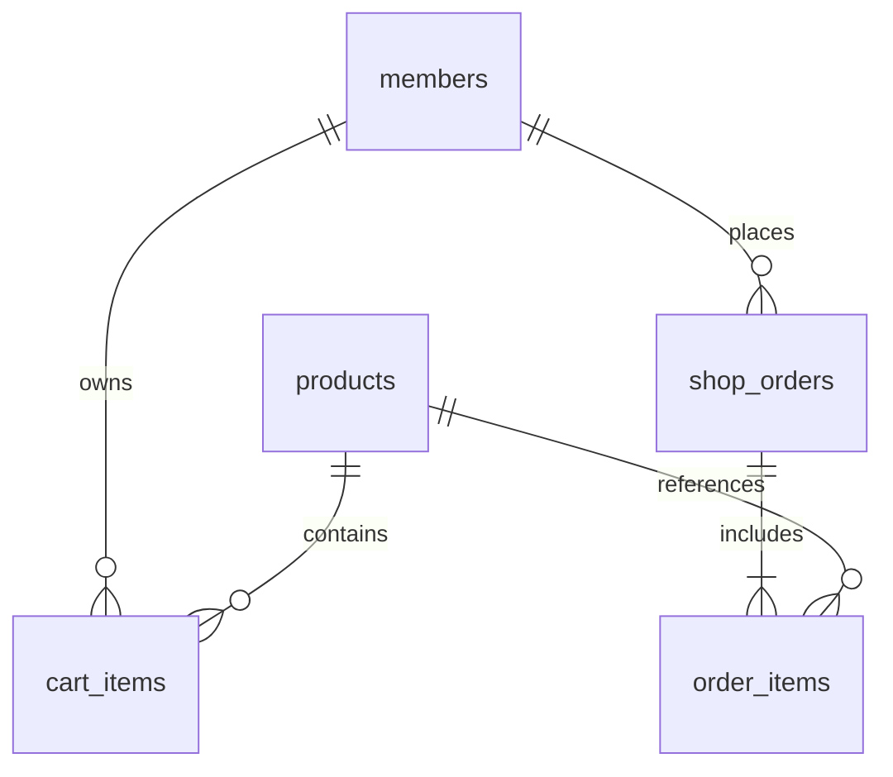

# TeamShop 개인 프로젝트 설계 정의서

생활용품 쇼핑몰을 주제로 한 개인 프로젝트입니다. 상품 탐색부터 주문·취소까지의 흐름을 설계하고 Spring MVC로 구현합니다.

## 주제 선정 및 기획 의도

생활용품 쇼핑몰을 주제로 선정했습니다. 후보인 의류 쇼핑몰은 사이즈·색상 옵션이 필요하고 식품 쇼핑몰은 유통기한·배송 조건이 필요합니다. 생활용품은 단일 상품 단위로 구매 흐름과 재고 트랜잭션을 집중 구현할 수 있어 학습 범위에 적합합니다.

사용자는 상품을 검색하고 자신의 장바구니를 관리한 뒤 배송정보를 입력해 주문합니다. 관리자는 상품과 재고를 관리합니다. 주문 당시 가격을 보관하고 재고 부족이나 중복 취소에도 데이터 일관성을 유지하는 것이 핵심 목표입니다. 실결제·배송·PG·환불·쿠폰·리뷰는 범위에 포함하지 않습니다.

## 요구사항 정의서

| ID | 분류 | 내용 | 우선순위 |
| --- | --- | --- | --- |
| R01 | 회원 | 이메일 중복 방지, 비밀번호 8~72자, BCrypt 저장 | 필수 |
| R02 | 로그인 | 세션 인증과 POST 로그아웃, CSRF 검사 | 필수 |
| R03 | 상품 탐색 | 상품명 검색, 3개 카테고리, 8개 단위 페이징 | 필수 |
| R04 | 장바구니 | 회원별 추가·수량 변경·삭제, 1~99개 제한 | 필수 |
| R05 | 주문 | 배송정보 입력, 서버 단가로 합계 재계산 | 필수 |
| R06 | 재고 | 행 잠금과 트랜잭션으로 차감·실패 롤백 | 필수 |
| R07 | 주문 취소 | 본인 주문만 취소, 재고 복원, 중복 취소 거절 | 필수 |
| R08 | 관리자 | 상품 등록·수정, 판매 중지·재개 | 필수 |
| R09 | 접근 제어 | 관리자 URL 차단, 타인 주문 조회·취소 거절 | 필수 |
| R10 | 사용 환경 | Java 17, H2 기본 실행, MySQL 설정 제공 | 필수 |

## 기능 정의서

| ID / 요구사항 | 기능 | 경로 | 처리 |
| --- | --- | --- | --- |
| F01 / R01 | 회원가입 | GET·POST /signup | 중복 이메일·비밀번호 검증 |
| F02 / R02 | 로그인·로그아웃 | /login, POST /logout | 세션 인증 |
| F03 / R03 | 목록·상세 | GET /, /products/{id} | 검색·카테고리·페이지 |
| F04 / R04 | 장바구니 | /cart, /cart/add | 추가·수량 변경·삭제 |
| F05 / R05~07 | 주문·취소 | /orders, /orders/{id} | 주문 생성·내역·본인 취소 |
| F06 / R08~09 | 상품관리 | /admin/products/** | 관리자만 등록·수정·중지 |

## 데이터 모델 ERD

cart_items는 회원·상품 조합을 유일하게 보관합니다. shop_orders와 order_items는 헤더·상세 구조입니다. 상품 물리 삭제를 막고 판매 상태만 변경해 주문 이력을 보존합니다. 주문 상품의 상품명·단가를 복사해 이후 상품 수정과 구분합니다.

## 테이블 정의서

### members

| 컬럼 | 자료형 | 제약·기본값 | 설명 |
| --- | --- | --- | --- |
| id | BIGINT | PK, AUTO_INCREMENT | 회원 식별자 |
| email | VARCHAR(150) | NOT NULL, UNIQUE | 로그인 이메일 |
| password | VARCHAR(100) | NOT NULL | BCrypt 해시 |
| name | VARCHAR(40) | NOT NULL | 회원 이름 |
| role | VARCHAR(20) | NOT NULL, 기본 USER | USER / ADMIN |

### products

| 컬럼 | 자료형 | 제약·기본값 | 설명 |
| --- | --- | --- | --- |
| id | BIGINT | PK, AUTO_INCREMENT | 상품 식별자 |
| name | VARCHAR(100) | NOT NULL | 상품명 |
| category | VARCHAR(30) | NOT NULL | 주방 / 리빙 / 문구 |
| description | VARCHAR(1500) | NOT NULL | 상품 설명 |
| price | INT | NOT NULL, 1~10,000,000 | 원 단위 가격 |
| stock | INT | NOT NULL, 0 이상 | 현재 재고 |
| active | BOOLEAN | NOT NULL, 기본 TRUE | 판매 여부 |

### cart_items

| 컬럼 | 자료형 | 제약·기본값 | 설명 |
| --- | --- | --- | --- |
| id | BIGINT | PK, AUTO_INCREMENT | 장바구니 항목 |
| member_id | BIGINT | NOT NULL, FK members.id | 소유 회원 |
| product_id | BIGINT | NOT NULL, FK products.id | 담은 상품 |
| quantity | INT | NOT NULL, 1~99 | 담은 수량 |

### shop_orders

| 컬럼 | 자료형 | 제약·기본값 | 설명 |
| --- | --- | --- | --- |
| id | BIGINT | PK, AUTO_INCREMENT | 주문 식별자 |
| member_id | BIGINT | NOT NULL, FK members.id | 주문 회원 |
| recipient | VARCHAR(40) | NOT NULL | 수령인 |
| address | VARCHAR(250) | NOT NULL | 배송 주소 |
| status | VARCHAR(20) | NOT NULL, 기본 PLACED | PLACED / CANCELLED |
| total | BIGINT | NOT NULL | 주문 총액 |
| created_at | TIMESTAMP | NOT NULL, CURRENT_TIMESTAMP | 주문 생성 시각 |

### order_items

| 컬럼 | 자료형 | 제약·기본값 | 설명 |
| --- | --- | --- | --- |
| id | BIGINT | PK, AUTO_INCREMENT | 주문 상품 식별자 |
| order_id | BIGINT | NOT NULL, FK shop_orders.id | 소속 주문 |
| product_id | BIGINT | NOT NULL, FK products.id | 원본 상품 |
| product_name | VARCHAR(100) | NOT NULL | 주문 당시 상품명 |
| unit_price | INT | NOT NULL | 주문 당시 단가 |
| quantity | INT | NOT NULL | 주문 수량 |

cart_items에는 UNIQUE(member_id, product_id)가 있습니다. 수량·상태·가격의 업무 규칙은 서비스와 입력 검증에서 추가 검사합니다. DDL은 docs/schema.sql과 일치합니다.

## 화면 정의서

| ID | 화면 | 경로 | 구성 | 검증 |
| --- | --- | --- | --- | --- |
| S01 | 상품 목록 | / | 검색어, 카테고리, 상품 목록, 이전·다음 | 검색조건 유지, 8개 단위 |
| S02 | 상품 상세 | /products/{id} | 상품명, 설명, 가격, 재고, 수량, 담기 | 품절 시 담기 비활성 |
| S03 | 회원가입·로그인 | /signup, /login | 이름, 이메일, 비밀번호 | 중복·길이·형식 검사 |
| S04 | 장바구니·주문 | /cart | 수량 변경, 삭제, 수령인, 주소, 합계 | 로그인·재고·필수 입력 |
| S05 | 주문내역·상세 | /orders, /orders/{id} | 주문번호, 상태, 당시 단가, 취소 | 본인만 접근, 취소 후 복원 |
| S06 | 관리자 상품관리 | /admin/products | 목록, 등록·수정, 판매 중지·재개 | ADMIN 권한 필요 |

## 사이트맵

- 공개: 상품 목록, 상품 상세, 로그인, 회원가입
- 회원: 장바구니, 주문내역, 주문상세·취소
- 관리자: 상품관리 목록, 상품 등록, 상품 수정, 판매 상태 변경

## 주문 처리

회원 행 잠금 후 장바구니를 읽습니다. 상품 ID 순으로 상품 행을 잠가 판매 상태와 재고를 확인합니다. 서버의 현재 단가로 총액을 계산하고 재고를 차감합니다. 주문 헤더·상세 저장과 장바구니 비우기까지 하나의 트랜잭션으로 처리합니다. 취소 시 주문 소유자와 PLACED 상태를 확인하고 재고를 복원합니다.

## 실행·검증 범위

H2에서 통합 테스트와 브라우저 시연을 수행합니다. MySQL 설정·DDL은 제공하지만 별도 MySQL 서버 연결은 검증하지 않았습니다.
